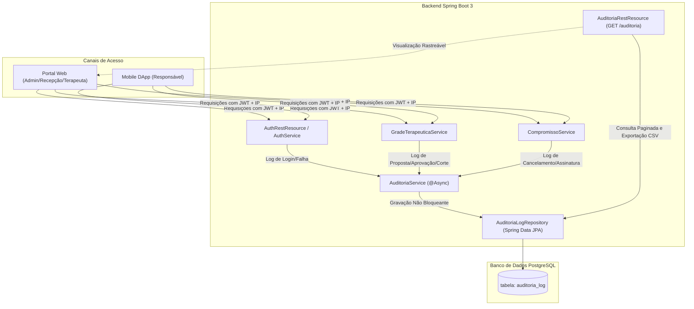

# Plano de Implementação: Módulo de Auditoria e Logs de Atividades (Audit Trail & LGPD)

> **Data:** 18/11/2026  
> **Status:** Proposta / Aguardando Aprovação  
> **Prioridade:** Alta (Conformidade LGPD, Segurança Jurídica e Governança Clínica)  

---

## 1. Contexto e Motivação

Atualmente, o DailyAutism gerencia operações críticas de saúde infantil, como diagnósticos, prontuários de intervenção comportamental (ABA), grades terapêuticas de longo prazo, controle de guias de planos de saúde, assinaturas digitais de responsáveis e repasses financeiros a profissionais.

No entanto, **o sistema ainda não possui uma camada centralizada de rastreabilidade (Audit Trail)**. Sem ela:
1. **Vulnerabilidade Regulatória (LGPD & CFM/CFP):** A LGPD exige que a clínica saiba exatamente *quem acessou*, *quando acessou* e *o que alterou* nos dados de saúde de menores de idade.
2. **Falta de Segurança Jurídica:** Em casos de contestações (ex: quem alterou o horário de um terapeuta, quem cancelou uma sessão ou quem rejeitou uma grade), não há prova irrefutável com IP e carimbo de tempo.
3. **Auditoria de Acessos:** Impossibilidade de detectar tentativas suspeitas de login (força bruta) ou vazamento de credenciais.

---

## 2. Arquitetura da Solução

---

## 3. Estrutura do Modelo de Dados (`auditoria_log`)

| Campo | Tipo | Descrição |
| :--- | :--- | :--- |
| `id` | `UUID PK` | Identificador único do registro de auditoria. |
| `dataHora` | `LocalDateTime` | Carimbo de data/hora exata do evento (UTC / Horário de Brasília). |
| `idUsuario` | `UUID FK (Nullable)` | ID do usuário autenticado que realizou a ação (nulo em tentativas de login com usuário inexistente). |
| `nomeUsuario` | `VARCHAR(150)` | Nome desnormalizado do usuário (preserva histórico mesmo se o usuário for excluído). |
| `loginUsuario` | `VARCHAR(100)` | E-mail ou username utilizado. |
| `perfilUsuario` | `VARCHAR(30)` | Perfil (`ADMIN`, `SECRETARIA`, `PROFISSIONAL`, `RESPONSAVEL`, `SISTEMA`). |
| `idClinica` | `UUID (Nullable)` | Clínica associada (para suporte multi-tenant). |
| `categoria` | `ENUM` | `AUTENTICACAO`, `CLINICO`, `GRADE_TERAPEUTICA`, `FINANCEIRO`, `CADASTRO`, `SEGURANCA`. |
| `acao` | `ENUM` | `LOGIN_SUCESSO`, `LOGIN_FALHA`, `LOGOUT`, `CRIACAO`, `EDICAO`, `EXCLUSAO`, `APROVACAO`, `REJEICAO`, `ASSINATURA_DIGITAL`, `CANCELAMENTO`, `EXPORTACAO`. |
| `entidade` | `VARCHAR(50)` | Nome da entidade impactada (ex: `Paciente`, `GradeTerapeutica`, `Compromisso`, `Usuario`). |
| `idEntidade` | `VARCHAR(100)` | ID/UUID do registro alterado ou consultado. |
| `descricao` | `VARCHAR(500)` | Resumo legível em português da ação (ex: *"Aprovou a Grade Terapêutica v1 do paciente Pedro Lucas"*). |
| `dadosAnteriores` | `TEXT (JSON)` | Snapshot em JSON do estado anterior da entidade (em alterações e exclusões). |
| `dadosNovos` | `TEXT (JSON)` | Snapshot em JSON do estado após a alteração. |
| `ipOrigem` | `VARCHAR(45)` | Endereço IP do cliente (capturado via `X-Forwarded-For` ou `request.getRemoteAddr()`). |
| `userAgent` | `VARCHAR(255)` | Navegador, sistema operacional e dispositivo do solicitante. |

---

## 4. Plano de Tarefas Passo a Passo

### Tarefa 1: Backend - Entidade, Enums e Repositório
* **Arquivos a Criar:**
  - `src/main/java/com/clinica/dailyautism/domain/enums/CategoriaAuditoria.java`
  - `src/main/java/com/clinica/dailyautism/domain/enums/AcaoAuditoria.java`
  - `src/main/java/com/clinica/dailyautism/domain/entity/AuditoriaLog.java`
  - `src/main/java/com/clinica/dailyautism/domain/repository/AuditoriaLogRepository.java`
  - `src/main/java/com/clinica/dailyautism/infrastructure/dto/AuditoriaLogDTO.java`
  - `src/main/java/com/clinica/dailyautism/infrastructure/dto/FiltroAuditoriaDTO.java`
* **Deliverable:** Entidade mapeada no JPA, repositório com suporte a `JpaSpecificationExecutor` e paginação.
* **Testes:** Teste de persistência e query por período e categoria.

---

### Tarefa 2: Backend - Serviço de Auditoria Assíncrono (`AuditoriaService`)
* **Arquivos a Criar/Modificar:**
  - `src/main/java/com/clinica/dailyautism/domain/aplicationservice/AuditoriaService.java`
  - `src/main/java/com/clinica/dailyautism/infrastructure/util/HttpRequestUtil.java` (extrator confiável de IP e User-Agent)
* **Funcionalidades:**
  - Métodos assíncronos (`@Async`) para não introduzir latência nas requisições normais de negócio:
    - `registrarAutenticacao(login, perfil, sucesso, motivo, ip, userAgent, idClinica)`
    - `registrarAcao(usuario, categoria, acao, entidade, idEntidade, descricao, dadosAnteriores, dadosNovos, ip, userAgent, idClinica)`
    - `buscarComFiltros(FiltroAuditoriaDTO filtro, Pageable pageable)`
    - `exportarCsv(FiltroAuditoriaDTO filtro)`
* **Deliverable:** Serviço completo de auditoria desacoplado e assíncrono.
* **Testes:** Teste unitário `AuditoriaServiceTest` cobrindo registro assíncrono e filtros.

---

### Tarefa 3: Backend - Instrumentação nos Fluxos Críticos & Controller REST
* **Arquivos a Criar/Modificar:**
  - `src/main/java/com/clinica/dailyautism/infrastructure/controller/AuditoriaRestResource.java`
  - `src/main/java/com/clinica/dailyautism/infrastructure/controller/AuthRestResource.java` (instrumentar logs de login bem-sucedido e falhas)
  - `src/main/java/com/clinica/dailyautism/domain/aplicationservice/GradeTerapeuticaService.java` (instrumentar propostas criadas, aprovações da família, alterações e cancelamentos de terapeutas)
  - `src/main/java/com/clinica/dailyautism/domain/aplicationservice/CompromissoService.java` (instrumentar agendamentos, faltas e assinaturas de guias)
* **Endpoints:**
  - `GET /auditoria` (Paginado, protegido por `hasRole('ADMIN')`)
  - `GET /auditoria/exportar` (Exportação CSV para compliance)
  - `GET /auditoria/{id}` (Detalhes completos do registro incluindo JSON antes/depois)
* **Deliverable:** Endpoint operacional restrito para ADMIN e logs sendo gerados automaticamente em operações do sistema.

---

### Tarefa 4: Frontend Web - Tipos, Serviços e Tela de Auditoria
* **Arquivos a Criar/Modificar:**
  - `frontend/src/types/auditoria.ts`
  - `frontend/src/services/auditoriaService.ts`
  - `frontend/src/pages/AuditoriaPage.tsx`
  - `frontend/src/components/auditoria/FiltrosAuditoriaBar.tsx`
  - `frontend/src/components/auditoria/DetalhesAuditoriaModal.tsx`
  - `frontend/src/components/AdminLayout.tsx` (Adicionar link "Auditoria" visível apenas para perfil `ADMIN`)
  - `frontend/src/routes.tsx` (Registrar `/admin/auditoria` sob proteção de rota)
* **Funcionalidades da UI:**
  - Filtro rápido por intervalo de datas (Últimos 7 dias, Este mês, Personalizado).
  - Filtro por categoria (Autenticação, Clínico, Grade, Financeiro) e por ação.
  - Campo de busca global por texto (busca por nome do usuário, paciente ou descrição).
  - Tabela com colunas: Data/Hora, Usuário/Perfil, Categoria/Ação, Entidade, Descrição e Ações.
  - Modal de Detalhes: exibe metadados de rede (IP e User-Agent) e o comparativo visual de alterações (dados anteriores vs. novos).
  - Botão de exportação para CSV.
* **Deliverable:** Interface rica e moderna integrada ao padrão visual do DailyAutism.
* **Testes:** Teste unitário em Vitest (`AuditoriaPage.test.tsx`).

---

### Tarefa 5: Validação, Deploy e Demonstração
* Executar suite de testes do frontend (`npm test`) e build (`npm run build`).
* Executar testes unitários do backend.
* Commit e push com deploy automático na OCI.
* Teste de ponta a ponta: realizar login, criar uma proposta de grade, aprovar e verificar o log refletido instantaneamente na tela de auditoria.

---

## 5. Perguntas de Alinhamento para o Usuário
1. Deseja que o log registre também operações normais de leitura/consulta (ex: "Visualizou prontuário do paciente X"), ou apenas operações de mutação (Criação, Edição, Exclusão, Aprovação, Cancelamento) e Autenticação (Login/Falha)?
   * *Recomendação:* Focar em mutações e autenticação para manter o banco leve, adicionando leitura apenas para prontuários sensíveis.
2. Apenas o perfil `ADMIN` terá acesso à tela de logs, ou a coordenação/gestão clínica também deve ter permissão de consulta?
